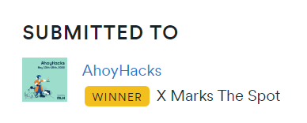
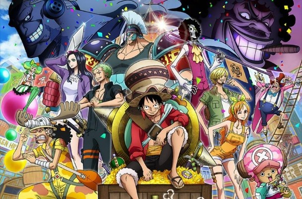
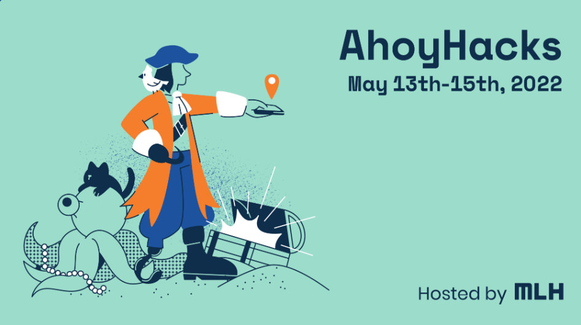

# AhoyHacks — Mapa da One Piece

**A Flutter app that charts the safest pirate-free route across the world of One Piece — winner of the "X Marks The Spot" prize at Ahoy! Hacks 2022.**




Demo video: [YouTube](https://youtu.be/ddZyEROSzJE)

## About

- **What:** A mobile navigation app set in the One Piece universe. Pick a start and a destination, and the app projects a hand-drawn world map onto a globe and traces the safest pirate-free route between them.
- **Who:** Built by Gyanesh Samanta with teammates **Eshaan Bhardwaj** ([@Eshaan-B](https://github.com/Eshaan-B)) and **Chetas Shree Madhusudhan** ([@ChetasShree](https://github.com/ChetasShree)).
- **When:** Hacked together 2022-05-13 to 2022-05-15, polished through 2022-06-10.
- **Where:** Built during **Ahoy! Hacks 2022**, where it won the "X Marks The Spot" category prize (Snapchat Spectacles).
- **Why:** The newly crowned Pirate King has set sail — non-pirates need a way to cross the Grand Line without picking fights with his fearsome crew.

## The Story

We watched the entire One Piece anime arc to identify the seas where pirate fleets are most active, then redrew the world map of the show in **Wonderdraft** so we could mark every safe-passage corridor by hand. The custom map was projected onto a 3D globe via the `map to globe` service to give navigation an immersive, planet-spinning feel rather than a flat 2D rectangle.

The app itself is a Flutter project with a themed pirate UI: pick a source and destination, and the globe re-renders to show the recommended route between them. Along the way we surface trivia about each leg — including in-universe stops like **Baratie**, the floating sea restaurant, in place of the petrol pumps a normal map app would suggest.

The biggest curveball: **`map to globe` went down for roughly the first 24 hours** of the hackathon, which forced an emergency hunt for an alternative rendering pipeline. We got it back online in time, finished the app, and walked away with the category prize.

## Gallery






---

## Tech Stack

- **Framework:** Flutter (Dart, SDK >=2.16.2 <3.0.0)
- **Key packages:** `webview_flutter`, `google_fonts`, `font_awesome_flutter`, `http`, `provider`
- **Map rendering:** `map to globe` (3D projection)
- **Cartography:** Wonderdraft (hand-drawn maps)
- **Tooling:** Git, GitHub

## Repo Structure

```
AhoyHacks/
├── lib/                    # Flutter / Dart source
├── android/  ios/          # native shells
├── assets/images/          # bundled image assets
├── Maps/                   # Wonderdraft source maps
├── Trivia/                 # in-app trivia content
├── Repository-Assests/     # hero/cover images for this README
├── pubspec.yaml            # Flutter package manifest
└── test/                   # widget tests
```

## Getting Started

```bash
# 1. Clone
git clone https://github.com/GyaneshSamanta/AhoyHacks.git
cd AhoyHacks

# 2. Make sure Flutter is installed (https://docs.flutter.dev/get-started/install)
flutter --version

# 3. Fetch packages
flutter pub get

# 4. Run on a connected Android device or emulator
flutter run
```

## Contributing

This is a hackathon repo and unlikely to see active development. Issues and PRs are welcome if you'd like to revive it — particularly the planned feature to **dynamically plot live pirate-ship positions** so users can sail around them.

## License

No formal license has been published. All code and art are the work of the three contributors above; please ask before reusing.

## Credits

| Name | GitHub |
| :--- | :--- |
| Gyanesh Samanta | [@GyaneshSamanta](https://github.com/GyaneshSamanta) |
| Eshaan Bhardwaj | [@Eshaan-B](https://github.com/Eshaan-B) |
| Chetas Shree Madhusudhan | [@ChetasShree](https://github.com/ChetasShree) |

One Piece, its world, and its characters belong to Eiichiro Oda / Shueisha — used here strictly as fan-project inspiration.
